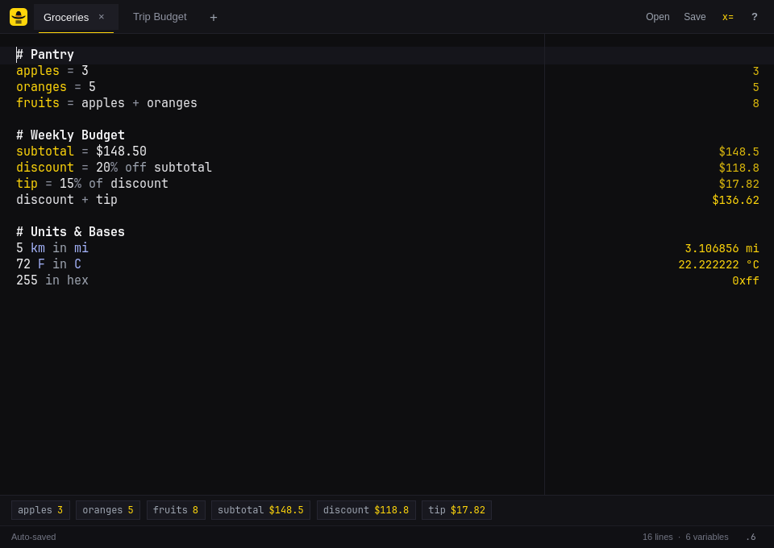

# Numbrero



A fast, lightweight native C++ and Qt Quick scratchpad calculator for Omarchy. Write plain text with variables, math functions, currencies, percentages, base conversions, and unit conversions, and see live results aligned beside every line.

## Features

- **Variables & implicit multiply:** `apples = 3`, `oranges = 5`, `fruits = apples + oranges`, `2(3 + 4)`, `2pi`, `3 apples`
- **Currencies & percentages:** `$12.50 + $8.20`, `€200 - 15%`, `20% off $150`, `20% of 150`, `250 kr * 2`
- **Units & conversions:** length (`km`, `mi`, `in`, `cm`), mass (`kg`, `lb`, `g`), temperature (`C`, `F`, `K`), time (`ms`, `s`, `min`, `h`, `d`), data (`KB`/`MB`/`GB` and `KiB`/`MiB`/`GiB`), area (`m2`, `sqft`, `ha`, `acre`), and volume (`mL`, `L`, `gal`, `cup`)
- **Number bases:** `0xff`, `0b1010_1100`, `0o755`, `255 in hex`, `42 in bin`, `511 in oct`, `0xff in dec`
- **Math functions & constants:** `sqrt`, `cbrt`, `abs`, `round`, `floor`, `ceil`, `sin`/`cos`/`tan`, `log`/`ln`/`log2`, `min`/`max`/`clamp`, `pi`, `e`, `tau`
- **Block aggregates:** `sum`, `total`, `avg`, `count`, `prev`/`ans` (scoped between blank lines or `# headings`)
- **Multiple sheets & search:** auto-saved scratchpad tabs, duplicate sheet, in-sheet find (`Ctrl+F`), configurable decimal precision (`.2`/`.4`/`.6`/`.8`), copy sheet with results, and Open / Save As via `xdg-desktop-portal`
- **Omarchy integration:** follows the live Omarchy accent color, Hyprland window rounding, and system language

## Keyboard Shortcuts

| Shortcut | Action |
|---|---|
| `Ctrl+T` | New sheet |
| `Ctrl+Shift+D` | Duplicate active sheet |
| `Ctrl+W` | Close active sheet |
| `Ctrl+Tab` / `Ctrl+Shift+Tab` | Next / previous sheet |
| `Ctrl+1` .. `Ctrl+9` | Jump to sheet |
| `F2` | Rename active sheet |
| `Ctrl+F` (`F3` / `Shift+F3`) | Find in sheet (next / previous match) |
| `Ctrl+O` | Open file |
| `Ctrl+S` / `Ctrl+Shift+S` | Save / Save As |
| `Ctrl+Shift+C` | Copy last result |
| `Ctrl+Shift+Y` | Copy sheet with inline results |
| `Ctrl+Shift+V` | Toggle variables bar |
| `Ctrl++` / `Ctrl+-` / `Ctrl+0` | Zoom editor text |
| `Ctrl+/` or `F1` | Toggle shortcuts & syntax help |
| `Ctrl+Q` | Quit |

## Headless CLI

```bash
numbrero eval -e $'apples = 3\noranges = 5\nfruits = apples + oranges'
numbrero eval sheet.txt --json
numbrero check sheet.txt --json
numbrero sheets --json
numbrero skill install
```

## Companion Omarchy Shell Plugin

`omarchy-plugin/` provides a bar widget and quick-calc popup (`numbrero.quickcalc`) backed by `numbrero eval --json`:

```bash
omarchy plugin validate ./omarchy-plugin
cp -r ./omarchy-plugin ~/.config/omarchy/plugins/numbrero.quickcalc
omarchy plugin enable numbrero.quickcalc
```

## Build, Install & Publish

```bash
./bin/build
./bin/test
./bin/install
```

Release packaging templates for `omarchy-pkgs` live under `packaging/omarchy-pkgs/pkgbuilds/numbrero/` (replace `OWNER` with your GitHub username/org and update `sha256sums` for a tagged `v0.1.0` release).
